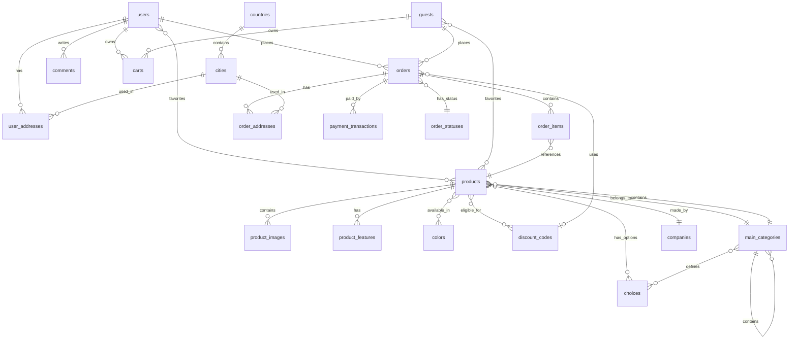

# Database Schema

## Database Overview

**Database Type**: MySQL  
**ORM**: Laravel Eloquent  
**Migration System**: Laravel Migrations (2024-2026 timestamps)

## Schema Summary

- **Total Tables**: 50+ tables
- **Pivot Tables**: 12+ (many-to-many relationships)
- **Core Entities**: Users, Products, Orders, Cart, Categories
- **Supporting Entities**: Countries, Cities, Colors, Companies, Shipping, Settings

## Core Tables

### users

Primary customer accounts table.

| Column | Type | Nullable | Default | Description |
|--------|------|----------|---------|-------------|
| id | BIGINT UNSIGNED | No | AUTO | Primary key |
| first_name | VARCHAR(255) | Yes | NULL | User first name |
| family_name | VARCHAR(255) | Yes | NULL | User family name |
| email | VARCHAR(255) | No | - | Unique email |
| password | VARCHAR(255) | No | - | Hashed password |
| phone_number | VARCHAR(255) | Yes | NULL | Contact phone |
| address | VARCHAR(255) | Yes | NULL | Default address |
| image | VARCHAR(255) | Yes | NULL | Profile image path |
| email_verified_at | TIMESTAMP | Yes | NULL | Verification timestamp |
| remember_token | VARCHAR(100) | Yes | NULL | Remember me token |
| created_at | TIMESTAMP | Yes | NULL | - |
| updated_at | TIMESTAMP | Yes | NULL | - |

**Relationships**:
- `hasOne` users_verificationCodes
- `hasMany` user_addresses
- `hasMany` orders
- `hasMany` comments
- `belongsToMany` products (wishlist_products_user)

**File**: `app/Models/User.php`  
**Migration**: `database/migrations/2014_10_12_000000_create_users_table.php`

### admins

Administrative user accounts.

| Column | Type | Nullable | Default | Description |
|--------|------|----------|---------|-------------|
| id | BIGINT UNSIGNED | No | AUTO | Primary key |
| name | VARCHAR(255) | No | - | Admin name |
| email | VARCHAR(255) | No | - | Unique email |
| password | VARCHAR(255) | No | - | Hashed password |
| super_admin | BOOLEAN | No | false | Super admin flag |
| image | VARCHAR(255) | Yes | NULL | Profile image |
| remember_token | VARCHAR(100) | Yes | NULL | - |
| created_at | TIMESTAMP | Yes | NULL | - |
| updated_at | TIMESTAMP | Yes | NULL | - |

**File**: `app/Models/Admin.php`  
**Migration**: `database/migrations/2024_01_01_000001_create_admins_table.php`

### guests

Temporary guest shoppers (cookie-based tracking).

| Column | Type | Nullable | Default | Description |
|--------|------|----------|---------|-------------|
| id | BIGINT UNSIGNED | No | AUTO | Primary key |
| cookie_id | VARCHAR(255) | No | UNIQUE | UUID for guest tracking |
| first_name | VARCHAR(255) | Yes | NULL | Guest first name |
| family_name | VARCHAR(255) | Yes | NULL | Guest family name |
| email | VARCHAR(255) | Yes | NULL | Guest email |
| phone_number | VARCHAR(255) | Yes | NULL | Contact number |
| address | VARCHAR(255) | Yes | NULL | Guest address |
| created_at | TIMESTAMP | Yes | NULL | - |
| updated_at | TIMESTAMP | Yes | NULL | - |

**Unique Constraint**: `cookie_id`

**Relationships**:
- `hasMany` orders (guest_id)
- `belongsToMany` products (wishlist_products_guest)

**File**: `app/Models/Guest.php`  
**Migration**: `database/migrations/2024_01_01_000006_create_guests_table.php`

### products

Product catalog.

| Column | Type | Nullable | Default | Description |
|--------|------|----------|---------|-------------|
| id | BIGINT UNSIGNED | No | AUTO | Primary key |
| name | VARCHAR(255) | No | - | Product name (Arabic) |
| name_en | VARCHAR(255) | Yes | NULL | Product name (English) |
| description | TEXT | Yes | NULL | Product description |
| image | VARCHAR(255) | Yes | NULL | Main product image |
| price | DECIMAL(10,2) | No | 0.00 | Base price |
| discount_price | DECIMAL(10,2) | Yes | NULL | Discounted price |
| status | ENUM | No | active | active, archived |
| category_id | BIGINT UNSIGNED | Yes | NULL | FK to main_categories |
| parent_id | BIGINT UNSIGNED | Yes | NULL | FK to main_categories (subcategory) |
| company_id | BIGINT UNSIGNED | Yes | NULL | FK to companies (brand) |
| main_category_setting_id | BIGINT UNSIGNED | Yes | NULL | FK to main_category_settings |
| product_availability_id | BIGINT UNSIGNED | Yes | NULL | FK to product_availabilities |
| quantity | INTEGER | No | 0 | Stock quantity |
| is_special | BOOLEAN | No | false | Featured product flag |
| weight | DECIMAL(8,2) | Yes | NULL | Product weight (kg) |
| slug | VARCHAR(255) | Yes | NULL | URL-friendly identifier |
| created_at | TIMESTAMP | Yes | NULL | - |
| updated_at | TIMESTAMP | Yes | NULL | - |

**Indexes**:
- Foreign keys on category_id, parent_id, company_id, main_category_setting_id, product_availability_id

**Relationships**:
- `belongsTo` main_categories (category_id)
- `belongsTo` main_categories (parent_id)
- `belongsTo` companies
- `hasMany` product_images
- `hasMany` product_features
- `belongsToMany` colors (color_product)
- `belongsToMany` choices (choices_products)
- `belongsToMany` orders (order_items pivot)

**File**: `app/Models/Product.php`  
**Migration**: `database/migrations/2024_01_01_000009_create_products_table.php`

### main_categories

Hierarchical product categories.

| Column | Type | Nullable | Default | Description |
|--------|------|----------|---------|-------------|
| id | BIGINT UNSIGNED | No | AUTO | Primary key |
| parent_id | BIGINT UNSIGNED | Yes | NULL | FK to main_categories (self-referencing) |
| name | VARCHAR(255) | No | - | Category name (Arabic) |
| name_en | VARCHAR(255) | Yes | NULL | Category name (English) |
| description | TEXT | Yes | NULL | Category description |
| image | VARCHAR(255) | Yes | NULL | Category image |
| slug | VARCHAR(255) | Yes | NULL | URL-friendly slug |
| created_at | TIMESTAMP | Yes | NULL | - |
| updated_at | TIMESTAMP | Yes | NULL | - |

**Self-Referencing**: parent_id allows nested categories

**Relationships**:
- `belongsTo` main_categories (parent_id)
- `hasMany` main_categories (parent_id)
- `hasMany` products (category_id)
- `belongsToMany` main_category_settings (pivot)
- `belongsToMany` choices (category_choices)

**File**: `app/Models/MainCategory.php`  
**Migration**: `database/migrations/2024_01_01_000007_create_categories_table.php`

### orders

Customer orders.

| Column | Type | Nullable | Default | Description |
|--------|------|----------|---------|-------------|
| id | BIGINT UNSIGNED | No | AUTO | Primary key |
| number | VARCHAR(255) | Yes | NULL | Order number (auto-generated) |
| user_id | BIGINT UNSIGNED | Yes | NULL | FK to users (authenticated) |
| guest_id | BIGINT UNSIGNED | Yes | NULL | FK to guests (guest checkout) |
| discount_code_id | BIGINT UNSIGNED | Yes | NULL | FK to discount_codes (applied discount) |
| cookie_id | VARCHAR(255) | Yes | NULL | Cookie identifier for guests |
| payment_method | VARCHAR(255) | Yes | NULL | cash_on_delivery, card_payment |
| status | VARCHAR(255) | No | pending | Order status |
| payment_status | VARCHAR(255) | No | unpaid | unpaid, paid, failed |
| order_status_id | BIGINT UNSIGNED | Yes | NULL | FK to order_statuses |
| return_order | BOOLEAN | No | false | Return order flag |
| note | TEXT | Yes | NULL | Customer note |
| totalBeforeDiscount | DECIMAL(10,2) | Yes | NULL | Subtotal before discount |
| total_price | DECIMAL(10,2) | No | 0.00 | Final total |
| shipping_price | DECIMAL(10,2) | No | 0.00 | Shipping cost |
| created_at | TIMESTAMP | Yes | NULL | - |
| updated_at | TIMESTAMP | Yes | NULL | - |

**Business Logic**:
- Order number generated via `Order::getNextOrderNumber()` (format: YYYY000001)
- Either user_id OR guest_id is set (not both)

**Relationships**:
- `belongsTo` users
- `belongsTo` guests
- `belongsTo` discount_codes
- `belongsTo` order_statuses
- `hasMany` order_items
- `hasMany` order_addresses
- `hasMany` payment_transactions
- `belongsToMany` products (order_items pivot)

**File**: `app/Models/Order.php`  
**Migration**: `database/migrations/2024_01_01_000012_create_orders_table.php`

### order_items

Order line items (pivot with extra fields).

| Column | Type | Nullable | Default | Description |
|--------|------|----------|---------|-------------|
| id | BIGINT UNSIGNED | No | AUTO | Primary key |
| order_id | BIGINT UNSIGNED | No | - | FK to orders (cascade) |
| product_id | BIGINT UNSIGNED | Yes | NULL | FK to products |
| product_name | VARCHAR(255) | Yes | NULL | Snapshot of product name |
| price | DECIMAL(10,2) | No | 0.00 | Snapshot of price |
| quantity | INTEGER | No | 1 | Quantity ordered |

**No timestamps**

**Relationships**:
- `belongsTo` orders
- `belongsTo` products
- `belongsToMany` choices (order_item_choices pivot)

**File**: `app/Models/OrderItem.php`  
**Migration**: `database/migrations/2024_01_01_000012_create_orders_table.php`

### carts

Shopping cart items.

| Column | Type | Nullable | Default | Description |
|--------|------|----------|---------|-------------|
| id | UUID | No | PRIMARY | UUID primary key |
| cookie_id | VARCHAR(255) | No | - | Cart identifier (UUID) |
| product_id | BIGINT UNSIGNED | No | - | FK to products (cascade) |
| user_id | BIGINT UNSIGNED | Yes | NULL | FK to users (authenticated) |
| guest_id | BIGINT UNSIGNED | Yes | NULL | FK to guests |
| color_id | BIGINT UNSIGNED | Yes | NULL | FK to colors (selected color) |
| quantity | INTEGER | No | 1 | Item quantity |
| weight | DECIMAL(8,2) | Yes | NULL | Item weight |
| discounted_price | DECIMAL(10,2) | Yes | NULL | Price after discount code |
| status | TINYINT | No | 0 | 0=active, 1=checked out |
| created_at | TIMESTAMP | Yes | NULL | - |
| updated_at | TIMESTAMP | Yes | NULL | - |

**Global Scope**: Automatically filters by cookie_id

**Business Logic**:
- UUID generated on creation
- cookie_id generated via `Cart::getCookieId()` or `Cart::getCookieIdApi()`
- Global scope limits queries to current user's cart

**Relationships**:
- `belongsTo` users
- `belongsTo` guests
- `belongsTo` products
- `belongsTo` colors

**File**: `app/Models/Cart.php`  
**Migration**: `database/migrations/2024_01_01_000011_create_cart_table.php`

### discount_codes

Promotional discount codes.

| Column | Type | Nullable | Default | Description |
|--------|------|----------|---------|-------------|
| id | BIGINT UNSIGNED | No | AUTO | Primary key |
| name | VARCHAR(255) | No | - | Discount name |
| code | VARCHAR(255) | No | UNIQUE | Discount code |
| price | DECIMAL(10,2) | No | 0.00 | Discount value |
| status | ENUM | No | active | active, inactive (added in migration 2026) |
| discount_type | VARCHAR(255) | No | fixed | fixed, percentage |
| number_of_used | INTEGER | No | 0 | Usage counter |
| product_ids | TEXT | Yes | NULL | JSON array of applicable product IDs |
| created_at | TIMESTAMP | Yes | NULL | - |
| updated_at | TIMESTAMP | Yes | NULL | - |

**Unique Constraint**: code

**Relationships**:
- `belongsToMany` products (discount_code_product)
- `hasMany` orders (discount_code_id)

**File**: `app/Models/DiscountCode.php`  
**Migration**: `database/migrations/2024_01_01_000010_create_discount_codes_table.php`

### countries

Country master data.

| Column | Type | Nullable | Default | Description |
|--------|------|----------|---------|-------------|
| id | BIGINT UNSIGNED | No | AUTO | Primary key |
| name_ar | VARCHAR(255) | No | - | Country name (Arabic) |
| name_en | VARCHAR(255) | No | - | Country name (English) |
| code | VARCHAR(255) | Yes | NULL | Country code (ISO) |
| phone_code | VARCHAR(255) | Yes | NULL | International dialing code |
| status | ENUM | No | not_used | used, not_used |

**No timestamps**

**Relationships**:
- `hasMany` cities
- `hasMany` user_addresses

**Migration**: `database/migrations/2024_01_01_000003_create_countries_cities_table.php`

### cities

City master data (with shipping prices).

| Column | Type | Nullable | Default | Description |
|--------|------|----------|---------|-------------|
| id | BIGINT UNSIGNED | No | AUTO | Primary key |
| name_ar | VARCHAR(255) | No | - | City name (Arabic) |
| name_en | VARCHAR(255) | Yes | NULL | City name (English) |
| code | VARCHAR(255) | Yes | NULL | City code |
| status | ENUM | No | not_used | used, not_used |
| shipping_price | DECIMAL(10,2) | No | 0.00 | Shipping cost for this city |
| country_id | BIGINT UNSIGNED | No | - | FK to countries (cascade) |

**No timestamps**

**Relationships**:
- `belongsTo` countries
- `hasMany` user_addresses

**File**: `app/Models/City.php`  
**Migration**: `database/migrations/2024_01_01_000003_create_countries_cities_table.php`

### companies

Brands/Manufacturers.

| Column | Type | Nullable | Default | Description |
|--------|------|----------|---------|-------------|
| id | BIGINT UNSIGNED | No | AUTO | Primary key |
| name | VARCHAR(255) | No | - | Company name (Arabic) |
| name_en | VARCHAR(255) | Yes | NULL | Company name (English) |
| image | VARCHAR(255) | Yes | NULL | Brand logo |
| created_at | TIMESTAMP | Yes | NULL | - |
| updated_at | TIMESTAMP | Yes | NULL | - |

**Relationships**:
- `hasMany` products

**File**: `app/Models/Company.php`  
**Migration**: `database/migrations/2024_01_01_000008_create_companies_colors_table.php`

### colors

Product color options.

| Column | Type | Nullable | Default | Description |
|--------|------|----------|---------|-------------|
| id | BIGINT UNSIGNED | No | AUTO | Primary key |
| name | VARCHAR(255) | No | - | Color name |
| color_code | VARCHAR(255) | No | - | Hex color code |

**No timestamps**

**Relationships**:
- `belongsToMany` products (color_product)

**File**: `app/Models/Color.php`  
**Migration**: `database/migrations/2024_01_01_000008_create_companies_colors_table.php`

### settings

Application-wide settings (singleton table).

| Column | Type | Nullable | Default | Description |
|--------|------|----------|---------|-------------|
| id | BIGINT UNSIGNED | No | AUTO | Primary key |
| website_name | VARCHAR(255) | Yes | NULL | Site name (Arabic) |
| website_name_en | VARCHAR(255) | Yes | NULL | Site name (English) |
| subscription_title | VARCHAR(255) | Yes | NULL | Newsletter subscription title |
| phone | VARCHAR(255) | Yes | NULL | Contact phone |
| phone_number | VARCHAR(255) | Yes | NULL | Alternate phone |
| image | VARCHAR(255) | Yes | NULL | Site image |
| logo | VARCHAR(255) | Yes | NULL | Site logo |
| email | VARCHAR(255) | Yes | NULL | Contact email |
| address | VARCHAR(255) | Yes | NULL | Physical address |
| description | TEXT | Yes | NULL | Site description |
| facebook | VARCHAR(255) | Yes | NULL | Facebook URL |
| twitter | VARCHAR(255) | Yes | NULL | Twitter URL |
| instagram | VARCHAR(255) | Yes | NULL | Instagram URL |
| snap | VARCHAR(255) | Yes | NULL | Snapchat URL |
| tiktok | VARCHAR(255) | Yes | NULL | TikTok URL |
| google_play | VARCHAR(255) | Yes | NULL | Google Play store URL |
| apple_store | VARCHAR(255) | Yes | NULL | App Store URL |
| tax_number | VARCHAR(255) | Yes | NULL | Tax registration number |
| value_added_tax | DECIMAL(5,2) | No | 0.00 | VAT percentage |
| publishable_key | VARCHAR(255) | Yes | NULL | Moyasar publishable key |
| secret_key | VARCHAR(255) | Yes | NULL | Moyasar secret key |
| sms_api_key | VARCHAR(255) | Yes | NULL | SMS service API key |
| sms_user_name | VARCHAR(255) | Yes | NULL | SMS service username |
| sms_sender | VARCHAR(255) | Yes | NULL | SMS sender name |
| created_at | TIMESTAMP | Yes | NULL | - |
| updated_at | TIMESTAMP | Yes | NULL | - |

**Additional Fields** (added in migration 2026):
- SEO fields: meta_title, meta_description, meta_keywords

**Usage**: Single-row configuration table

**File**: `app/Models/Setting.php`  
**Migration**: `database/migrations/2024_01_01_000015_create_settings_table.php`

### payment_transactions

Payment gateway transaction records.

| Column | Type | Nullable | Default | Description |
|--------|------|----------|---------|-------------|
| id | BIGINT UNSIGNED | No | AUTO | Primary key |
| order_id | BIGINT UNSIGNED | No | - | FK to orders (cascade) |
| moyasar_payment_id | VARCHAR(255) | Yes | NULL | Moyasar payment ID (indexed) |
| status | VARCHAR(255) | No | - | paid, failed, initiated, authorized |
| amount | DECIMAL(10,2) | No | - | Payment amount (SAR) |
| currency | VARCHAR(10) | No | SAR | Currency code |
| payment_method | VARCHAR(255) | Yes | NULL | creditcard, stcpay, applepay |
| card_brand | VARCHAR(255) | Yes | NULL | visa, mastercard, mada |
| card_last_four | VARCHAR(4) | Yes | NULL | Last 4 digits of card |
| description | VARCHAR(255) | Yes | NULL | Payment description |
| raw_response | TEXT | Yes | NULL | Full JSON response from Moyasar |
| ip_address | VARCHAR(45) | Yes | NULL | Customer IP address |
| created_at | TIMESTAMP | Yes | NULL | - |
| updated_at | TIMESTAMP | Yes | NULL | - |

**Index**: moyasar_payment_id

**Relationships**:
- `belongsTo` orders

**File**: `app/Models/PaymentTransaction.php`  
**Migration**: `database/migrations/2026_04_05_171613_create_payment_transactions_table.php`

## Supporting Tables

### user_addresses

Saved customer addresses.

| Column | Type | Nullable | Default | Description |
|--------|------|----------|---------|-------------|
| id | BIGINT UNSIGNED | No | AUTO | Primary key |
| user_id | BIGINT UNSIGNED | No | - | FK to users (cascade) |
| address_title | VARCHAR(255) | Yes | NULL | Address label |
| first_name | VARCHAR(255) | No | - | Recipient first name |
| family_name | VARCHAR(255) | Yes | NULL | Recipient family name |
| phone_number | VARCHAR(255) | Yes | NULL | Contact phone |
| address | VARCHAR(255) | Yes | NULL | Street address |
| city_id | BIGINT UNSIGNED | Yes | NULL | FK to cities |
| country_id | BIGINT UNSIGNED | Yes | NULL | FK to countries |
| main_address | BOOLEAN | No | false | Default address flag |

**No timestamps**

**File**: `app/Models/UserAddress.php`  
**Migration**: `database/migrations/2024_01_01_000005_create_users_extended_table.php`

### order_addresses

Order shipping/billing addresses (snapshot).

| Column | Type | Nullable | Default | Description |
|--------|------|----------|---------|-------------|
| id | BIGINT UNSIGNED | No | AUTO | Primary key |
| order_id | BIGINT UNSIGNED | No | - | FK to orders (cascade) |
| type | VARCHAR(255) | No | shipping | shipping, billing |
| first_name | VARCHAR(255) | Yes | NULL | - |
| last_name | VARCHAR(255) | Yes | NULL | - |
| email | VARCHAR(255) | Yes | NULL | - |
| phone_number | VARCHAR(255) | Yes | NULL | - |
| country_id | BIGINT UNSIGNED | Yes | NULL | FK to countries |
| city_id | BIGINT UNSIGNED | Yes | NULL | FK to cities |
| address | VARCHAR(255) | Yes | NULL | - |

**No timestamps**

**File**: `app/Models/OrderAddress.php`  
**Migration**: `database/migrations/2024_01_01_000012_create_orders_table.php`

### product_images

Product gallery images.

| Column | Type | Nullable | Default | Description |
|--------|------|----------|---------|-------------|
| id | BIGINT UNSIGNED | No | AUTO | Primary key |
| image | VARCHAR(255) | No | - | Image path |
| product_id | BIGINT UNSIGNED | No | - | FK to products (cascade) |
| created_at | TIMESTAMP | Yes | NULL | - |
| updated_at | TIMESTAMP | Yes | NULL | - |

**File**: `app/Models/ProductImage.php`  
**Migration**: `database/migrations/2024_01_01_000009_create_products_table.php`

### product_features

Product specifications/features.

| Column | Type | Nullable | Default | Description |
|--------|------|----------|---------|-------------|
| id | BIGINT UNSIGNED | No | AUTO | Primary key |
| feature_name | VARCHAR(255) | No | - | Feature name |
| feature_name_en | VARCHAR(255) | Yes | NULL | Feature name (English) |
| feature_description | TEXT | Yes | NULL | Feature value |
| product_id | BIGINT UNSIGNED | No | - | FK to products (cascade) |

**No timestamps**

**File**: `app/Models/ProductFeature.php`  
**Migration**: `database/migrations/2024_01_01_000009_create_products_table.php`

### choices

Product variant options (hierarchical).

| Column | Type | Nullable | Default | Description |
|--------|------|----------|---------|-------------|
| id | BIGINT UNSIGNED | No | AUTO | Primary key |
| name | VARCHAR(255) | No | - | Choice name (Arabic) |
| name_en | VARCHAR(255) | Yes | NULL | Choice name (English) |
| parent_id | BIGINT UNSIGNED | Yes | NULL | FK to choices (self-referencing) |
| created_at | TIMESTAMP | Yes | NULL | - |
| updated_at | TIMESTAMP | Yes | NULL | - |

**Self-Referencing**: parent_id allows nested choices (e.g., Size -> Small, Medium, Large)

**File**: `app/Models/Choice.php`  
**Migration**: `database/migrations/2024_01_01_000007_create_categories_table.php`

### order_statuses

Order status types (customizable).

| Column | Type | Nullable | Default | Description |
|--------|------|----------|---------|-------------|
| id | BIGINT UNSIGNED | No | AUTO | Primary key |
| name | VARCHAR(255) | No | - | Status name (Arabic) |
| name_en | VARCHAR(255) | Yes | NULL | Status name (English) |
| default_status | BOOLEAN | No | false | Default for new orders |
| arrangement | INTEGER | No | 0 | Display order |

**No timestamps**

**File**: `app/Models/OrderStatus.php`  
**Migration**: `database/migrations/2024_01_01_000012_create_orders_table.php`

### shipping_types_and_price

Shipping configuration (singleton table).

| Column | Type | Nullable | Default | Description |
|--------|------|----------|---------|-------------|
| id | BIGINT UNSIGNED | No | AUTO | Primary key |
| add_pickup_from_store | BOOLEAN | No | false | Enable pickup option |
| add_wight_price | BOOLEAN | No | false | Enable weight-based shipping |
| add_normal_price | BOOLEAN | No | false | Enable fixed shipping |
| add_price_based_on_city | BOOLEAN | No | false | Enable city-based shipping |
| weight_price | DECIMAL(10,2) | No | 0.00 | Price per kg |
| normal_shipping_price | DECIMAL(10,2) | No | 0.00 | Fixed shipping price |

**No timestamps**

**File**: `app/Models/ShippingTypesAndPrice.php`  
**Migration**: `database/migrations/2024_01_01_000013_create_shipping_table.php`

### comments

Product reviews and ratings.

| Column | Type | Nullable | Default | Description |
|--------|------|----------|---------|-------------|
| id | BIGINT UNSIGNED | No | AUTO | Primary key |
| user_id | BIGINT UNSIGNED | No | - | FK to users (cascade) |
| product_id | BIGINT UNSIGNED | No | - | FK to products (cascade) |
| comment | TEXT | Yes | NULL | Review text |
| rate | UNSIGNED TINYINT | No | 0 | Rating (0-5) |
| created_at | TIMESTAMP | Yes | NULL | - |
| updated_at | TIMESTAMP | Yes | NULL | - |

**File**: `app/Models/Comment.php`  
**Migration**: `database/migrations/2024_01_01_000015_create_settings_table.php`

## Pivot Tables (Many-to-Many Relationships)

### color_product

**Columns**: color_id, product_id (composite primary key)

**Relationship**: Products can have multiple colors

**Migration**: `database/migrations/2024_01_01_000009_create_products_table.php`

### choices_products

**Columns**: choice_id, product_id (composite primary key)

**Relationship**: Products can have multiple choices/variants

**Migration**: `database/migrations/2024_01_01_000009_create_products_table.php`

### category_choices

**Columns**: main_category_id, choice_id (composite primary key)

**Relationship**: Categories define which choices are applicable

**Migration**: `database/migrations/2024_01_01_000007_create_categories_table.php`

### discount_code_product

**Columns**: discount_code_id, product_id (composite primary key)

**Relationship**: Discount codes can apply to specific products

**Migration**: `database/migrations/2024_01_01_000010_create_discount_codes_table.php`

### wishlist_products_user

**Columns**: user_id, product_id (composite primary key)

**Relationship**: User favorites/wishlist

**Migration**: `database/migrations/2024_01_01_000009_create_products_table.php`

### wishlist_products_guest

**Columns**: guest_id, product_id (composite primary key)

**Relationship**: Guest favorites/wishlist

**Migration**: `database/migrations/2024_01_01_000009_create_products_table.php`

### main_category_main_category_setting

**Columns**: main_category_id, category_setting_id, timestamps

**Relationship**: Categories can have multiple settings

**Migration**: `database/migrations/2024_01_01_000007_create_categories_table.php`

### product_sub_settings

**Columns**: product_id, sub_settings_id (composite primary key)

**Relationship**: Products can have multiple sub-settings

**Migration**: `database/migrations/2024_01_01_000009_create_products_table.php`

### order_choices

**Columns**: order_id, choice_id, sub_choice_id, timestamps

**Relationship**: Orders can track selected product choices

**Migration**: `database/migrations/2024_01_01_000012_create_orders_table.php`

### order_item_choices

**Columns**: order_item_id, choice_id, sub_choice_id, timestamps

**Relationship**: Order items track selected variants

**Migration**: `database/migrations/2024_01_01_000012_create_orders_table.php`

## Entity Relationship Diagram



## Database Indexes

### Verified Indexes

**Foreign Key Indexes** (automatically created):
- All foreign key columns have indexes
- Examples: `products.category_id`, `orders.user_id`, `carts.product_id`

**Unique Indexes**:
- `users.email`
- `admins.email`
- `guests.cookie_id`
- `discount_codes.code`
- `payment_transactions.moyasar_payment_id`

**RECOMMENDED Additional Indexes**:
- `products.slug` (frequent lookups)
- `products.status` (filtering)
- `orders.number` (lookups)
- `orders.payment_status` (reporting)
- `carts.cookie_id` (already has global scope, but explicit index recommended)

## Data Integrity

### Cascade Behaviors

**Cascade on Delete**:
- User deleted → addresses, orders, comments deleted
- Product deleted → images, features, cart items deleted
- Order deleted → order items, addresses, transactions deleted
- Category deleted → subcategories, products set to NULL

**Null on Delete**:
- Country deleted → cities' country_id set to NULL
- Company deleted → products' company_id set to NULL

### Soft Deletes

**Soft Delete Implementation** (VERIFIED):
- Products: NOT using soft deletes (archive via `status = 'archived'` instead)

### Data Validation

**Enum Values**:
- `products.status`: active, archived
- `orders.status`: pending (and custom statuses from order_statuses table)
- `orders.payment_status`: unpaid, paid, failed
- `countries.status`: used, not_used
- `cities.status`: used, not_used
- `currencies.status`: used, not_used
- `discount_codes.status`: active, inactive

### Default Values

Important defaults:
- `products.quantity = 0`
- `products.price = 0.00`
- `products.status = 'active'`
- `carts.quantity = 1`
- `carts.status = 0`
- `orders.payment_status = 'unpaid'`
- `orders.status = 'pending'`
- `settings.value_added_tax = 0.00`

## Database Transactions

**Verified Transaction Usage**:

1. **Checkout Process** (`CheckoutServices.php`):
```php
DB::beginTransaction();
try {
    // Create order
    // Create order items
    // Update product quantities
    // Create addresses
    DB::commit();
} catch (Throwable $e) {
    DB::rollBack();
}
```

2. **User Registration** (`UserService.php`):
```php
DB::transaction(function () {
    // Create user
    // Create default address
});
```

## Query Optimization Considerations

### Potential N+1 Queries

**Identified Locations**:
- Product listings without eager loading relationships
- Order lists without loading items/addresses

**RECOMMENDED**: Use eager loading
```php
Product::with(['images', 'colors', 'company', 'parent'])->get();
Order::with(['orderItems.product', 'addresses', 'user'])->get();
```

### Missing Indexes

**RECOMMENDED**:
- Add index on `products.slug`
- Add composite index on `orders(user_id, payment_status)`
- Add index on `carts(user_id, status)`

## Database Seeding

**Seeders Location**: `database/seeders/`

**UNKNOWN**: Specific seeder implementations not inspected

**INFERRED**: Standard Laravel seeding for:
- Admin users
- Countries and cities
- Default order statuses
- Sample products (possibly)

## Database Backup Strategy

**UNKNOWN**: No backup strategy defined in repository

**RECOMMENDED**:
- Daily automated backups
- Transaction log backups (MySQL binary logs)
- Off-site backup storage

## Known Database Issues

### 1. Inconsistent Timestamps

**Issue**: Some tables lack `created_at`/`updated_at`
- `colors`: No timestamps
- `countries`: No timestamps
- `cities`: No timestamps
- `user_addresses`: No timestamps
- `order_addresses`: No timestamps

### 2. Mixed Naming Conventions

**Issue**: Inconsistent table/column naming
- Some use underscores: `main_category_settings`
- Some use camelCase in columns: `totalBeforeDiscount`

### 3. Choice System Complexity

**Issue**: `choices` table with self-referencing can become complex
**Risk**: Deep nesting difficult to query efficiently

### 4. Global Scope on Cart

**Issue**: Global scope can cause confusion when admin needs to view all carts
**Mitigation**: Remember to use `withoutGlobalScope('cookie_id')`

## Performance Considerations

1. **Large Text Fields**: `raw_response` in payment_transactions can grow large
2. **Denormalization**: Order addresses are denormalized (good for historical accuracy)
3. **Product Quantity**: Updated frequently during orders (potential lock contention)
4. **Cart Status**: Status flag for active/inactive carts prevents cart table bloat

## Database Migration Strategy

**Migration Naming**: Chronological with date prefixes (2024_01_01, 2026_03_25)

**Migration Safety**:
- All migrations check for existing tables: `if (!Schema::hasTable(...))`
- All migrations check for existing columns: `if (!Schema::hasColumn(...))`

**Rollback Support**: All migrations implement `down()` method
